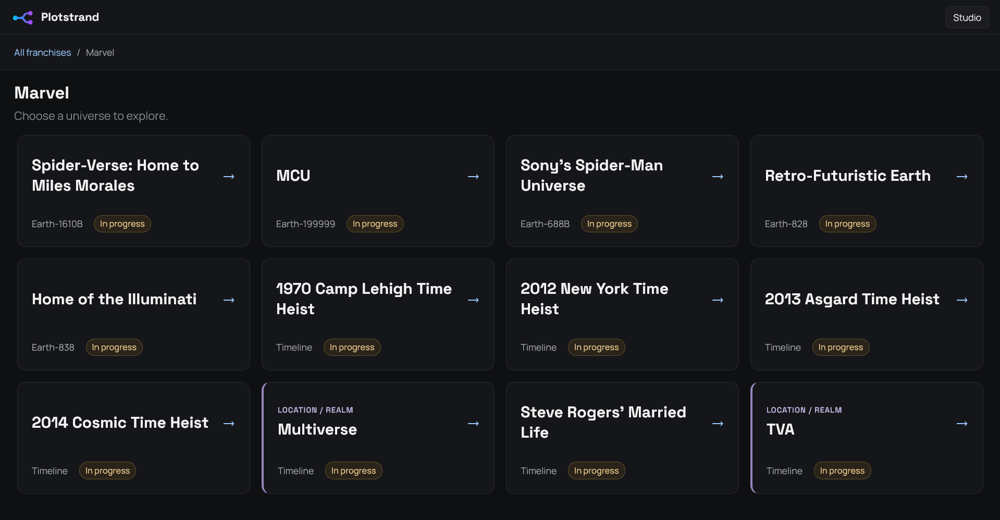
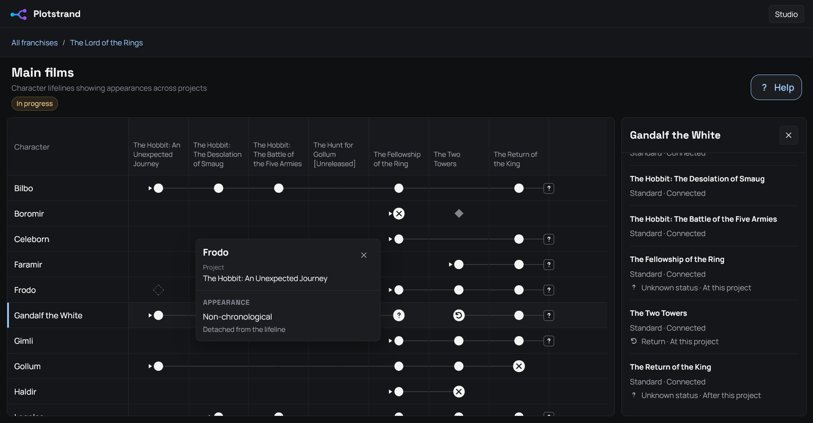
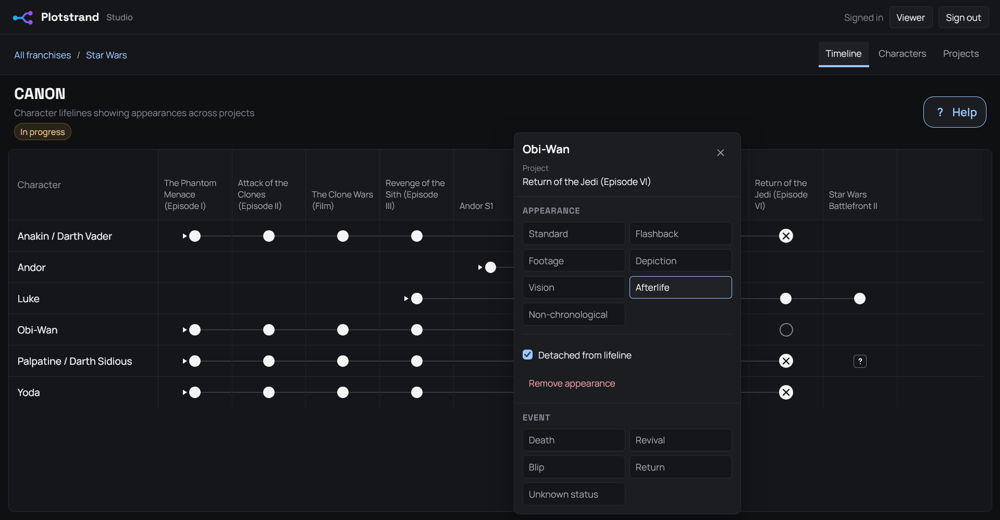
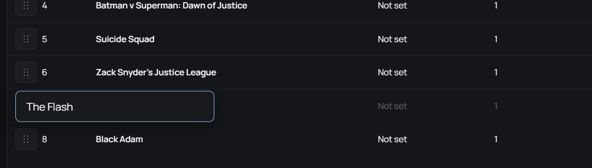

# Plotstrand — Fictional Timelines

_A personal tool for creating and exploring fictional timelines,
starting with the Marvel Cinematic Universe._

Inspired by an Excel workflow, Plotstrand uses character rows,
chronological project columns and visual lifelines to track appearances
and events within each universe.

## Current version — `0.8.0`

Studio projects support drag-and-drop and placement by project title. Project forms keep the release date picker within the form on narrow screens.

**Previous:** touch-friendly timeline editing, support for locations and realms, searchable compact management pages, and clearer cell details and controls.

See the [development plan](docs/development-plan.md).

> 

> 

> 

> 

> 

## Aim

Make fictional universes easier to explore through timelines, character histories, project details and statistics.

## Screenshots

See the [progress screenshots](docs/images).

## Stack

## Database

Supabase is the source of truth. Files in [docs/supabase](docs/supabase) are
database references, not files the app runs to create its database. They were
refreshed from read-only live metadata on 20 October 2026 and include the
universe-specific entry constraints, publication policies and application functions.
The coverage-status column and constraint were additionally verified on 1 November 2026.
They are reference snapshots rather than complete database backups.

